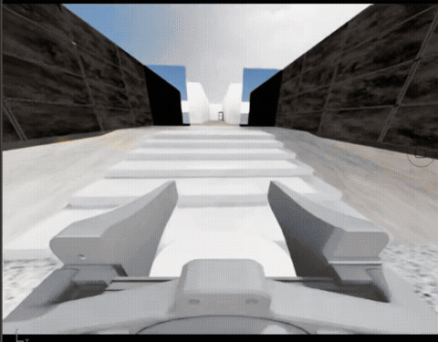
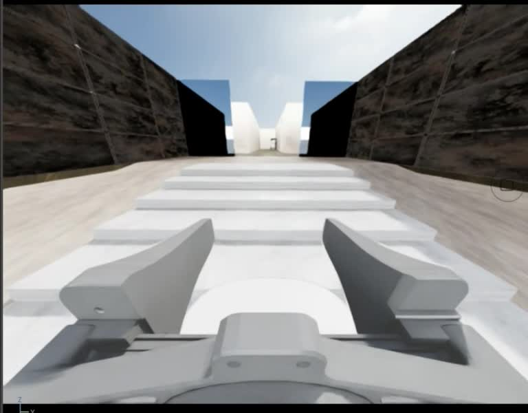
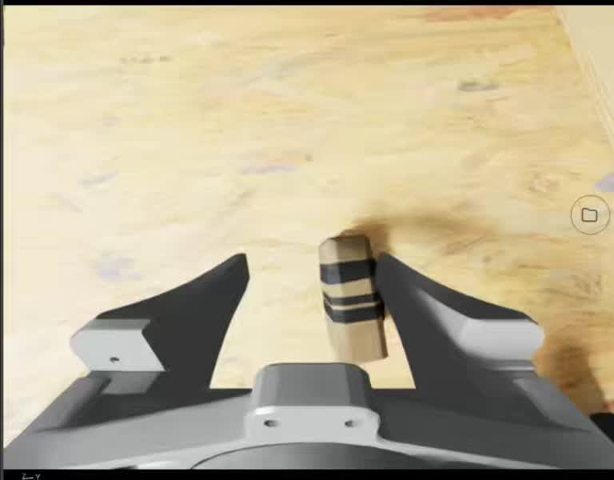
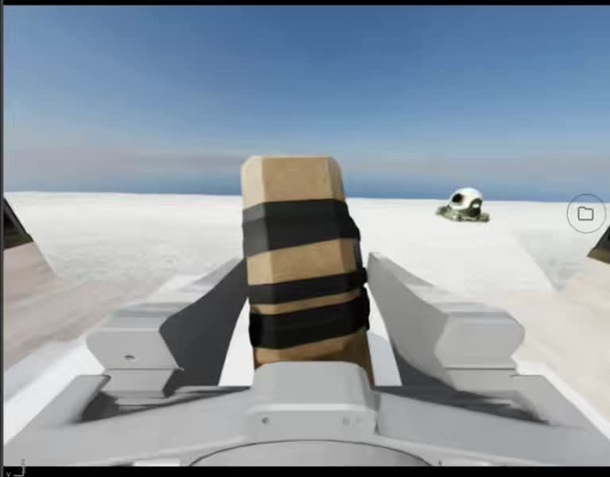
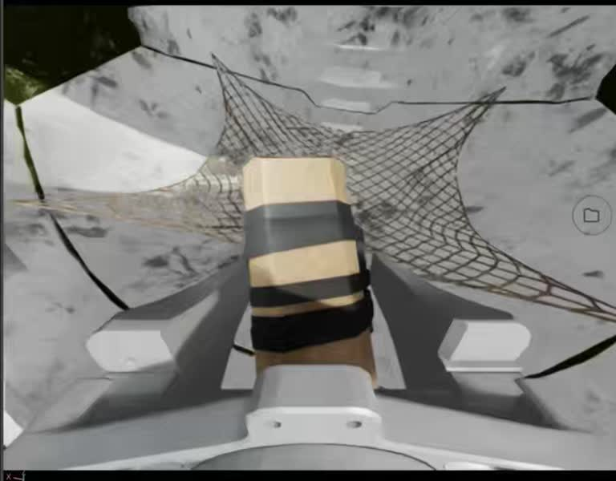

# 基于π0.5的轮足机器人具身智能全栈开发

**让轮足机器人在室内跨楼层移动，寻找目标，完成抓取、运输与定点投放。**

B2W 轮足底盘 × Piper 机械臂 × π0.5 视觉语言动作模型。围绕真实任务需求，串联仿真环境、遥操作采集、模型微调和机器人闭环控制。

[](docs/media/demo.mp4)

**[▶ 查看 40 秒任务视频](https://github.com/waferen/pi05-wheellegged-embodied-fullstack/raw/refs/heads/main/docs/media/demo.mp4)** · [下载场景与权重](#资源下载) · [开始采集](#windows-mujoco)

> 演示素材来自维护者提供的 Isaac Sim 运行录像，已裁切相机视图并剪辑。它展示任务流程，不代表本仓库最新 MuJoCo 单演示 LoRA 已完成自主任务；实际测试边界见文末。

## 要解决什么需求

在存在楼梯、狭窄通道和不同高度目标的室内环境中，让机器人完成一条连续作业链：

**上楼与通行 → 搜索并接近目标 → 调整低位/高位姿态 → 夹持目标 → 跨区域运输 → 放入指定容器。**

这需要把底盘移动、机械臂和夹爪控制连接起来，并利用头部与夹爪两路视觉观测判断下一步动作。

| 跨楼层移动 | 接近与抓取 |
| --- | --- |
|  |  |
| **携带目标运输** | **向指定容器投放** |
|  |  |

## 这个仓库包含什么

| 环节 | 实现 |
| --- | --- |
| 仿真与控制 | Isaac Sim 源工程、MuJoCo 场景迁移、轮足运动控制与机械臂/夹爪适配 |
| 数据采集 | 双相机遥操作、14阶段标记、50 Hz状态动作记录、HDF5图像压缩与自动解码 |
| 数据处理 | 成功回合审核、LeRobot转换、双阶段标签、归一化与动作接口检查 |
| 模型训练 | OpenPI π0.5、双LoRA低显存微调、可恢复检查点 |
| 闭环评估 | 模型服务、异步动作预取、可见MuJoCo双视角、轨迹录像及切换诊断 |

## 资源下载

场景、机器人模型、贴图和大模型权重不进入 Git 历史，已由维护者上传至百度网盘。

**[下载：网盘上传_轮足机器人资源](https://pan.baidu.com/s/1mz10MpnmnGziQe_8JOcqnw?pwd=mnyg)** · **提取码：`mnyg`**

资源总计约 **35.54 GB**，包含以下四个 ZIP 及校验清单、校验脚本和恢复说明。

| 文件 | 内容 |
| --- | --- |
| 01_原始场景与机器人.zip | 原始酒店场景、机器人模型、原小脑权重 |
| 02_MuJoCo场景与材质.zip | 转换后的 MuJoCo 场景、网格、贴图、USD 层和材质 |
| 03_pi05训练与推理权重.zip | run01/40000 推理检查点、最新3000更新LoRA完整检查点及统计量 |
| 04_ROS机械臂模型.zip | Piper ROS机械臂网格与模型配套文件 |
| 资源校验清单.json | 压缩包和内部文件的大小、SHA-256及目标路径 |

下载后先核对压缩包 SHA-256，再将四个 ZIP **全部解压到本仓库根目录**，与现有 `competition_local/` 合并。不要把ZIP文件名当作额外一层目录。资源包不含演示数据、虚拟环境、WSL系统盘、旧检查点或缓存。


资源包已在本地完成打包和ZIP完整性校验，总计 **35.54 GB**。逐文件及压缩包SHA-256见 [资源清单](resources/manifest.json)。将 `resources/verify_resources.py` 与下载的ZIP、`manifest.json`放在一起时，需将清单重命名为`资源校验清单.json`后运行校验；网盘上传目录已包含可直接运行的`校验资源.py`。

## 目录导航

- `competition_local/cloud_snapshot/PPSUC2026/`：Isaac原工程源码、配置与采集模块。
- `competition_local/cloud_snapshot/openpi/`：OpenPI源码及本项目双阶段策略适配。
- `competition_local/mujoco_hotel/`：场景转换、控制器、双相机、π0.5推理与采集pipeline。
- `competition_local/mujoco_finetune_ep0_v2/`：最新独立单演示LoRA实验代码。
- `competition_local/pi05_low_memory/`、`wsl_setup/`：低显存配置、Linux依赖与本机安装脚本。
- 独立数据标注工具：[c4-robot-annotation](https://github.com/waferen/c4-robot-annotation)。

## Windows MuJoCo

源码快照基于 Windows Python3.12，实际安装版本见 `competition_local/requirements.lock.txt`。先安装相应Python并恢复资源：

```powershell
cd competition_local
powershell -ExecutionPolicy Bypass -File .\setup_windows.ps1
.\.venv\Scripts\python.exe -m pip install h5py msgpack
.\.venv\Scripts\python.exe -m pip install -e .\cloud_snapshot\openpi\packages\openpi-client
powershell -ExecutionPolicy Bypass -File .\view_hotel.ps1
```

采集双相机演示（头部、夹爪）：

```powershell
powershell -ExecutionPolicy Bypass -File .\collect_mujoco.ps1 -OperatorName teammate
```

F1开始、F2下一阶段、F3保存，F6中断保留partial。新HDF5图像为JPEG95，状态/动作保持无损，回放与转换自动解码。完整说明见 [采集文档](competition_local/mujoco_hotel/collection/README.md)。

## π0.5 训练与推理

π0.5使用WSL/Linux环境，JAX CUDA与Windows仿真分离。环境及依赖参考 [WSL说明](competition_local/wsl_setup/README.md) 与 [低显存说明](competition_local/pi05_low_memory/README.md)。源码中 `/home/eai/ppsuc`、发行版名称和本机路径需要按部署环境调整；这些脚本是本机实验快照，不是零配置安装器。`wsl_setup`中的系统安装/重启脚本不应在已有环境直接执行。

先审核成功演示，再转换成LeRobot。最新实验的 `experiment.py`、`prepare.py`、`train.py`、`serve.py`分别负责配置、归一化和契约检查、训练、服务。`run.py`会实际启动训练；本发布包不包含演示数据，需自行采集并修改实验的数据路径、帧数与阶段边界。默认不能直接复用单回合的17674帧断言。

原40000推理服务入口为 `competition_local/serve_pi05.ps1`，MuJoCo入口为 `view_pi05.ps1`。最新LoRA服务使用 `mujoco_finetune_ep0_v2/serve.py`，默认端口8767。启动前核对检查点、统计量和端口，避免把原权重与LoRA统计量混用。

## 已知结果与限制

- 原run01/40000来自Isaac遥操作数据训练，已迁移并实际读取验证。
- 单条成功MuJoCo演示完成3000次双LoRA更新，batch1、BF16冻结主权重、关闭EMA；是LoRA，不是4bit QLoRA。
- 420秒自主MuJoCo评估未完成抓取入仓；机器人未可靠退出楼梯模式。
- 离线检查显示维持已有模式的准确率高，但模式切换和双阶段推进仍有缺陷。训练损失和普通帧准确率不能代表任务成功率。
- 当前只有单演示拟合与有限闭环测试，尚未验证泛化或完整任务成功。
